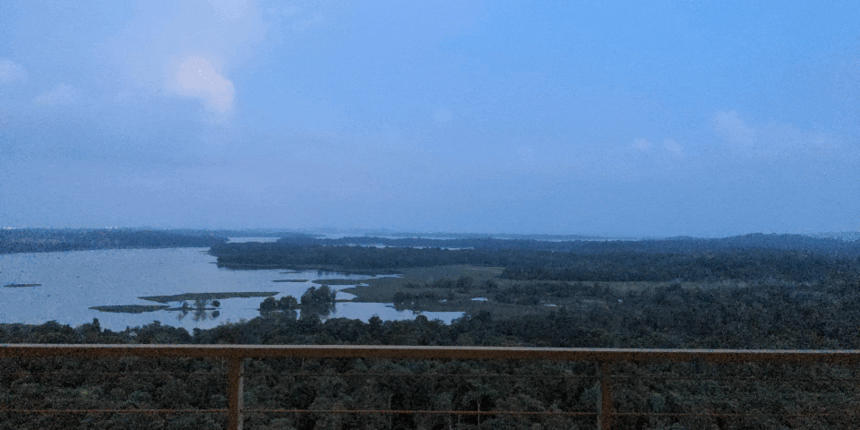

# GNOME-Wallpaper-Collection
This is a collection of self-made time-shifting and auto-switching wallpapers for the GNOME desktop.

## Overview
- [Available Wallpapers](#Available-Wallpapers)
    - *[Time-shifting wallpapers](#Time-shifting-wallpapers)*
    - *[Auto-switching wallpapers](#Auto-switching-wallpapers)*
- [How to Contribute](#How-to-Contribute)
    - *[You know how it works](#You-know-how-it-works)*
    - *[You don't know how it works](#You-don't-know-how-it-works)*
    - *[You want to learn it](#You-want-to-learn-it)*
- [Contribution-Guidlines](#Contribution-Guidelines)
    - *[It's an time-shifting wallpaper](#It's-an-time-shifting-wallpaper)*
    - *[It's an auto-switching wallpaper](#It's-an-auto-switching-wallpaper)*
    - *[Supported image file format](#Supported-image-file-format)*
- [Installation](#Installation)
    - *[How to install a time-shifting wallpaper](#How-to-install-a-timeshifting-wallpaper)*
    - *[How to install an auto-switching wallpaper](#How-to-install-an-auto-switching-wallpaper)*
- [Legal & Privacy](#Legal-&-Privacy)
- [Contributors](#Contributors)
    - *[For the time-shifting wallpapers](#For-the-time-shifting-wallpapers)*
    - *[For the auto-switching wallpapers](#For-the-auto-switch-wallpapers)*
- [Disclaimer](#Disclaimer)

## Available Wallpapers
#### Time-shifting wallpapers
**landscape_lake**:

#### Auto-switching wallpapers
|    **landscape_cross** |    **flight_wing** |    **landscape_pool** |
|-----------------------------------------------------------------------------------|--------------------------------------------------------------|--------------------------------------------------------------------------|
|    **abstract_mac_tahoe** |

*Currently are there no more available wallpapers. I hope it will be more soon. Feel free too contribute your own!*

## How to Contribute
If you want to contribute are there multiple ways to do that:

#### You know how it works
If you know how to build your own wallpaper for GNOME and you want to contribute to this project do the following steps:
1) Fork and clone this repository
2) Build your wallpaper by configuring the .xml files
3) Name all files and folders so they match to the regulations
4) Store the .xml files and images into the correct folders, which are either called "time-shifting wallpaper" or "auto-switching wallpaper".
5) If the wallpapers are working correctly, make a Pull Request

*(The moment your wallpaper is part of this project, you will be listed as a "Wallpaper contributor".)*

#### You don't know how it works
If you don't know how to create an wallpaper for GNOME follow these steps:
1) Collect the wallpapers into one Folder
2) Name all files and folders so they match to the regulations
3) Send an E-Mail at Roland.Fabian@pm.me containing following things:
   - The name of your wallpaper
   - The permission I'm allowed to use the images you sent me
   - The folder containing the images
   - Wheter you want me to make a time-shifted or auto-switching wallpaper. Both is fine too.
4) Wait until I add your wallpaper to this project
5) Check if everything is fine with you. If not please contact me via the E-Mail from above again.

*(The moment your wallpaper was added to this project you will be listed as a "Image contributor".)*

#### You want to learn it
If you want to learn how you can create such an GNOME wallpaper, feel free to open a discussion. But please clarify in its header whether it's about time-shifting or auto-switching wallpapers.

**Please respect the copyright of the images you use. If you don't own the copyright or if you aren't allowed to publish these images don't add them to this project. I'm not able to prove that, but using others images without permission might be a crime! So check its license first.**

## Contribution Guidlines
If you want to contribute please satisfy the following regulations depending on its type of wallpaper:

#### It's an time-shifting wallpaper
1) Make sure you have the **copyright** of the images or are allowed to publish them
2) Please store the image files with the .xml file, which manages their order, into an folder an store that folder into "/time-shifting wallpaper/backgrounds/". Please respect those regulations:
   - Call the folder like this: `<category>_<object>`
   - Call the image files like this: `<category>_<object>_<time_it's_displayed>`
   - Call the .xml file like this: `<category>_<object_configuration>.xml`
3) Please store the other .xml into "/time-shifting wallpaper/gnome-background-properties/" and call it like that: `<category>_<object>_registration.xml`

#### It's an auto-switching wallpaper
1) Make sure you have the **copyright** of the images or are allowed to publish them
2) Please store the images into a folder into "/auto-switch wallpaper/backgrounds/". Please respect those regulations:
   - Call the folder like this: `<category>_<object>`
   - Call the image files like this:
       - light mode images: `<category>_<object>-l`
       - dark mode images: `<category>_<object>-d`
3) Please store the .xml file into "/auto-switch wallpaper/gnome-background-properties/" and name it like this: `<category>_<object>_registration.xml`

#### Supported image file format
Currently are there two image file formats that will work for sure:
- .jpg/.jepg
- .png

*(This are the image file formats I already tested. I think others will work too.)*

## Installation:
#### How to install a time-shifting wallpaper
If you wan't to install a time-shifting wallpaper follow these steps:
- Download the folder of the wallpaper you want from */time-shifting wallpaper/backgrounds*
- Download the .xml of the wallpaper you want from */time-shifting wallpaper/gnome-background-properties*
- Move the folder containing the images and an .xml to "/usr/share/backgrounds/gnome":

      sudo mv /Path/to/folder /usr/share/backgrounds/gnome/
  If prompted enter your root passwort. You might need to create the folder "gnome" as its not always there:

      sudo mkdir /usr/share/backgrounds/gnome
  Then try moving the folder of the images again.
- Finally you need to move the .xml file, which you downloaded from "/time-shifting wallpaper/gnome-background-properties", to "/usr/share/gnome-background-properties":

      sudo mv /Path/to/xml /usr/share/gnome-background-properties
- Now should you be able to select the wallpaper from your settings.

*(If you need help create a new issue and select "Help needed")*

#### How to install an auto-switching wallpaper
If you want to install an auto-switching wallpaper follow these steps:
- Download the two image files of the wallpaper you want from */auto-switch wallpaper/backgrounds/*
- Download the .xml file of your wallpaper from */auto-switch wallpaper/gnome-background-properties/*
- Move the folder containing the two image files to "usr/share/backgrounds/gnome/":

      sudo mv /Path/to/folder /usr/share/backgrounds/gnome/
  If prompted enter your root passwort. You might need to create the folder "gnome" as its not always there:

      sudo mkdir /usr/share/backgrounds/gnome
  Then try moving the images again.
- Finally you need to move the .xml file, which you downloaded, to "/usr/share/gnome-background-properties":

      sudo mv /Path/to/xml /usr/share/gnome-background-properties
- Now should you be able to select the wallpaper from your settings.

*(If you need help create a new issue and select "Help needed")*

## Legal & Privacy
Those projects doesn't collect and share any kind of data.

## Contributors

### For the time-shifting wallpapers:

###### Wallpaper Contributors
  - **Fabian Roland** contributed:
      - "landscape_lake"

###### Image Contributors

*(There are currently no Image contributors)*

### For the auto-switching wallpapers

###### Wallpaper Contributor
  - **naibaf-1** contributed:
      - "landscape_cross"
      - "flight_wing"
      - "landscape_pool"
  - **vinceluice** contributed:
      - "abstract_mac_tahoe"

###### Image Contributors

*(There are currently no Image contributors)*

## Disclaimer
I created this project, because I like time-shifted wallpapers. I know this feature from MacOS and I want to bring it to GNOME too. But that's not all: I think it's important to
spend more time enjoying the beauty of our earth and not just the computer games and so on. I think a lot of people are spending a lot of time at there PC.
I hope I got your interest and I want to appeal to you: **Go out and enjoy the beauty of the earth around your stay!**

If you want, share these experience either by contributing your own wallpaper to this repository. But please take care of the **Copyright** of the images.
